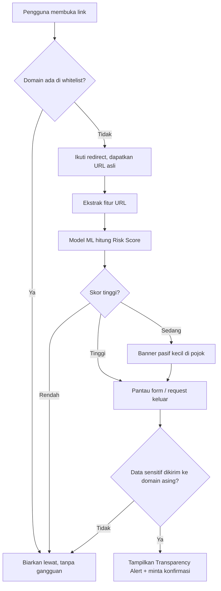

# 🛡️ Ekstensi Anti-Phishing Zero-Day dengan Transparansi Data

> Dokumen ini menjelaskan ide proyek, arsitektur, dan MVP untuk kelompok. Ditulis sesederhana mungkin supaya semua anggota (termasuk yang belum paham ML atau ekstensi browser) bisa ikut mengerti.

---

## 1. Ringkasan Singkat (baca ini dulu)

Kita membuat **ekstensi browser** yang melindungi pengguna dari **phishing yang belum dikenal (zero-day)**.

Bedanya dengan kebanyakan proteksi yang ada:

| Proteksi biasa | Ekstensi kita |
|---|---|
| Cek URL ke daftar hitam (blacklist) | Menilai **perilaku** halaman + **ciri-ciri URL** dengan ML |
| Kalau URL belum ada di daftar → lolos | Tetap bisa terdeteksi walau URL baru / lewat link shortener |
| Langsung blokir tanpa penjelasan | **Memberi tahu pengguna** data apa yang akan dikirim dan ke mana |
| Sering kirim data browsing ke server | ML jalan **di dalam browser** (privasi terjaga) |

**Satu kalimat pitch:**
*"Ekstensi yang tidak cuma bilang 'halaman ini bahaya', tapi menunjukkan **kenapa** dan **data apa** yang sedang dicuri, tanpa mengirim riwayat browsing kamu ke mana-mana."*

---

## 2. Masalah yang Ingin Diselesaikan

1. **Blacklist selalu terlambat.** Database seperti PhishTank atau Google Safe Browsing baru memuat URL setelah ada yang melapor. Phisher cukup membuat domain baru setiap hari.
2. **Link shortener menyembunyikan tujuan.** Link seperti `bit.ly/xxxx` tidak bisa dinilai dari tampilannya, padahal tujuan akhirnya bisa situs palsu.
3. **Pengguna tidak tahu apa yang terjadi.** Saat mengisi form di situs palsu, pengguna tidak sadar passwordnya dikirim ke server orang lain.
4. **Peringatan yang terlalu sering mengganggu.** Kalau ekstensi cerewet di situs aman (misal web kampus), orang akan uninstall. Ini disebut **alert fatigue**.

---

## 3. Ide Inti: 3 Pilar

### Pilar 1 — Analisis URL & Tujuan Akhir
- Ikuti rantai redirect dari link shortener sampai ketemu URL tujuan akhir.
- Hitung ciri-ciri URL (fitur leksikal): panjang URL, jumlah titik, ada IP mentah atau tidak, dll.

### Pilar 2 — Pemantauan Pengiriman Data (Request Monitor)
- Pantau saat pengguna menekan **Submit** pada form atau halaman mengirim data lewat `fetch`/`XHR`.
- Cek: **apakah data sensitif (password, kartu kredit) dikirim ke domain lain yang berbeda dari halaman yang sedang dibuka?**

### Pilar 3 — ML Lokal + Alert yang Transparan
- Model ML kecil menghitung **Risk Score (0–100%)** langsung di browser.
- Kalau berisiko, tampilkan banner yang menjelaskan alasannya dengan bahasa sederhana.

---

## 4. Cara Kerja (Alur Besar)



**Contoh ceritanya:**
1. Korban klik link `bit.ly/abc` dari chat.
2. Ekstensi menelusuri redirect → tujuan akhir ternyata `login-kampus.free-host.app` (domain berumur 2 hari).
3. Model memberi skor risiko 87%.
4. Korban mengisi password lalu menekan Submit → ekstensi mendeteksi password akan dikirim ke `collector.ngrok-free.app`.
5. Muncul peringatan: *"Halaman ini mencoba mengirim **password** kamu ke **collector.ngrok-free.app**, bukan ke situs yang sedang kamu buka. Lanjutkan?"*

---

## 5. Arsitektur Sistem

### 5.1 Komponen Utama

```
┌─────────────────────────── Browser (Chrome / Edge) ───────────────────────────┐
│                                                                                │
│  ┌──────────────────┐     pesan     ┌─────────────────────────────────────┐   │
│  │  Content Script  │ ───────────▶ │        Background Service Worker     │   │
│  │ (jalan di halaman)│ ◀─────────── │                                     │   │
│  │ - deteksi form    │               │  - Whitelist Checker                │   │
│  │ - tangkap submit  │               │  - URL Unshortener (redirect chain) │   │
│  │ - cek field       │               │  - Feature Extractor                │   │
│  │   password        │               │  - ML Engine (model lokal)          │   │
│  │ - tampilkan banner│               │  - Cache (chrome.storage.local)     │   │
│  └──────────────────┘               └─────────────────────────────────────┘   │
│                                                                                │
│  ┌──────────────────┐                                                          │
│  │  Popup / Options │  ← pengaturan: whitelist, riwayat peringatan, on/off     │
│  └──────────────────┘                                                          │
└────────────────────────────────────────────────────────────────────────────────┘
```

### 5.2 Tugas Tiap Komponen

| Komponen | Tugas | Catatan |
|---|---|---|
| **Whitelist Checker** | Cek apakah domain termasuk tepercaya (termasuk subdomain). Contoh: kalau `its.ac.id` tepercaya, maka `integra.its.ac.id` otomatis ikut. | Pakai pencocokan akhiran domain, bukan sekadar `includes()` (hati-hati `its.ac.id.evil.com`). |
| **URL Unshortener** | Mengikuti redirect untuk menemukan URL tujuan. | Pakai `fetch` dengan `redirect: "manual"` atau baca hasil redirect via `webNavigation`. |
| **Feature Extractor** | Mengubah URL jadi angka-angka (fitur) untuk model. | Lihat tabel fitur di bagian 6. |
| **ML Engine** | Menghitung probabilitas phishing. | Jalan lokal, tanpa API luar. |
| **Request/Form Monitor** | Mendeteksi pengiriman data sensitif lintas domain. | Paling mudah lewat content script (lihat 5.3). |
| **Transparency UI** | Banner/modal berisi alasan dan rincian data. | Bahasa sederhana, bukan istilah teknis. |
| **Cache** | Simpan skor tiap domain supaya tidak dihitung ulang. | Kasih masa kedaluwarsa (misal 24 jam). |

### 5.3 Dua Cara Memantau Data Keluar (pilih satu untuk MVP)

| Cara | Kelebihan | Kekurangan |
|---|---|---|
| **A. Content script** (dengarkan event `submit` + bungkus `fetch`/`XHR` di halaman) | Mudah, bisa tahu jenis field (`type="password"`), cocok untuk demo | Bisa dilewati oleh halaman yang sangat canggih |
| **B. `chrome.webRequest` (mode baca-saja)** | Melihat request di level jaringan | Di Manifest V3 tidak bisa memblokir secara bebas, dan isi body lebih sulit dibaca |

👉 **Rekomendasi MVP: pakai cara A.** Lebih cepat dibuat dan hasilnya langsung terlihat di demo. Cara B bisa jadi pengembangan lanjutan.

### 5.4 Teknologi yang Disarankan

| Bagian | Pilihan |
|---|---|
| Ekstensi | Manifest V3, JavaScript/TypeScript |
| Pelatihan model | Python + scikit-learn (Random Forest / Decision Tree) |
| Model di browser | ONNX Runtime Web **atau** model diekspor jadi JSON (aturan pohon keputusan) |
| UI banner | HTML/CSS biasa (Shadow DOM supaya tidak bentrok dengan CSS halaman) |
| Penyimpanan | `chrome.storage.local` |

> 💡 **Tips penyederhanaan:** kalau ONNX terasa ribet, mulai dari Decision Tree kecil yang diekspor jadi JSON dan dievaluasi dengan fungsi JavaScript biasa. Hasil demo sama, risikonya jauh lebih kecil.

---

## 6. Bagian Machine Learning (Versi Sederhana)

### 6.1 Apa yang Diprediksi?
Input: fitur-fitur dari URL → Output: **peluang phishing (0–100%)**.

### 6.2 Fitur yang Dipakai

| Fitur | Penjelasan | Kenapa mencurigakan |
|---|---|---|
| `URLLength` | Panjang URL | Phishing sering panjang untuk menyembunyikan tujuan |
| `NumDots` | Jumlah titik di URL | Banyak titik → banyak subdomain palsu |
| `HasIP` | Host berupa angka IP | Situs resmi hampir tidak pernah pakai IP mentah |
| `SubdomainCount` | Jumlah subdomain | `login.secure.bank.palsu.com` |
| `HasAtSymbol` | Ada karakter `@` | Trik menyembunyikan domain asli |
| `NumHyphens` | Jumlah tanda `-` | `secure-login-bank-update.com` |
| `IsHTTPS` | Pakai HTTPS atau tidak | Bukan jaminan aman, tapi tetap sinyal tambahan |
| `RedirectCount` | Jumlah redirect | Banyak loncatan → mencurigakan |
| `DomainAge` *(opsional)* | Umur domain | Phishing zero-day biasanya baru dibuat |

### 6.3 Alur Pelatihan Model

1. **Ambil dataset** URL phishing vs legit (contoh sumber: UCI Phishing Websites, PhiUSIIL Phishing URL, atau dataset di Kaggle; cek lisensi dan format-nya dulu).
2. **Pilih hanya fitur yang bisa dihitung ulang di ekstensi.** Ini penting: kalau model dilatih dengan fitur yang tidak bisa kita hitung di browser, modelnya tidak akan terpakai.
3. **Latih** Random Forest / Decision Tree, lalu cek akurasi, *precision*, dan *recall*.
4. **Ekspor** ke JSON atau ONNX.
5. **Uji** di ekstensi dengan URL nyata, bandingkan hasilnya dengan hasil di Python (harus sama).

### 6.4 Metrik yang Perlu Diperhatikan
- **False positive** (situs aman dianggap berbahaya) → bikin pengguna kesal, usahakan serendah mungkin.
- **False negative** (phishing lolos) → bahaya sebenarnya.
- Jangan hanya melihat akurasi; lihat juga *precision* dan *recall*.

---

## 7. Risk Score dan Level Peringatan

| Skor | Level | Tindakan |
|---|---|---|
| 0–39% | 🟢 Aman | Tidak ada gangguan sama sekali |
| 40–69% | 🟡 Waspada | Banner kecil pasif, halaman tetap bisa dipakai |
| 70–100% | 🔴 Berbahaya | Pantau form; kalau data sensitif akan dikirim ke domain asing → tampilkan peringatan penuh yang meminta konfirmasi |

*(Angka ambang di atas hanya titik awal, nanti disetel berdasarkan hasil uji.)*

**Isi Transparency Alert (contoh):**
```
⚠️ Peringatan Keamanan
Halaman ini (login-kampus.free-host.app) mencoba mengirim:
  • Password  →  collector.ngrok-free.app
  • Email     →  collector.ngrok-free.app

Alasan peringatan:
  • Domain tampak baru dan tidak dikenal
  • Data dikirim ke domain berbeda dari halaman ini
  • Skor risiko: 87%

[ Batalkan ]   [ Tetap lanjut ]   [ Percayai situs ini ]
```

---

## 8. Menghindari Alert Fatigue & Loading Lambat

Kekhawatiran paling penting: **jangan sampai ekstensi bikin jengkel di situs yang memang aman.** Solusinya:

| Masalah | Solusi |
|---|---|
| Situs aman (web kampus) terus ditanyai | **Whitelist** domain + semua subdomain resminya; tombol "Percayai situs ini" |
| Halaman jadi lambat | Analisis berjalan **di latar belakang (asinkron)**, halaman tidak ditahan |
| Terlalu banyak popup | Peringatan penuh **hanya** jika *skor tinggi* **dan** *data sensitif dikirim lintas domain* |
| Hitung ulang terus | **Cache** skor per domain |
| Analitik pihak ketiga (Google Analytics, dll.) memicu alarm | Daftar domain analitik tepercaya dikecualikan |
| Model berat dijalankan di semua request | Jalankan hanya pada **navigasi utama** dan **pengiriman form/fetch/XHR**, bukan gambar/CSS/script |

**Prinsipnya:** *diam kalau aman, bersuara hanya kalau benar-benar perlu.*

---

## 9. MVP (Minimum Viable Product)

Target: bisa dibuat dalam **24–48 jam** dan **demo-nya mulus**. Lebih baik 1 alur yang solid daripada 10 fitur setengah jadi.

### ✅ Wajib Ada (Core)

1. **Feature Extractor** untuk URL (`URLLength`, `NumDots`, `HasIP`, `SubdomainCount`, `HasAtSymbol`, `NumHyphens`, `IsHTTPS`).
2. **Unshortener** sederhana: ikuti redirect dan ambil URL akhir.
3. **Model ML kecil** berjalan di browser → Risk Score 0–100%.
4. **Form Monitor**: deteksi submit form yang berisi field password, lalu cek apakah tujuan pengiriman berbeda domain.
5. **Transparency Banner**: tampilkan skor, alasan, data yang akan dikirim, dan domain tujuan.
6. **Whitelist** sederhana (daftar domain di dalam kode) + tombol "Percayai situs ini".

### 🟡 Boleh Di-mock / Disederhanakan

| Fitur | Cara menyederhanakan untuk MVP |
|---|---|
| Umur domain (WHOIS/RDAP) | Isi data palsu untuk domain demo, atau lewati; API sering lambat dan terbatas |
| Whitelist lengkap | Cukup array berisi ±50–100 domain populer + domain kampus |
| Backend/server | **Tidak perlu.** Semua jalan di dalam ekstensi |
| Analisis konten halaman (HTML/visual) | Lewati dulu |

### ❌ Tidak Dikerjakan di MVP (Simpan untuk "Future Work")
- Analisis visual halaman (deteksi tiruan logo/tampilan bank).
- Sinkronisasi pengaturan antar perangkat.
- Dukungan Firefox/Safari.
- Dashboard statistik.
- Pelaporan komunitas.

---

## 10. Struktur Folder yang Disarankan

```
phishing-guard/
├── extension/
│   ├── manifest.json            # konfigurasi MV3
│   ├── background.js            # service worker: unshortener, ML, cache
│   ├── content.js               # pantau form/fetch, tampilkan banner
│   ├── features.js              # fungsi ekstraksi fitur URL
│   ├── model/
│   │   └── model.json           # hasil ekspor model (atau model.onnx)
│   ├── whitelist.js             # daftar domain tepercaya
│   ├── ui/
│   │   ├── banner.css
│   │   └── popup.html
│   └── icons/
├── ml/
│   ├── train.ipynb              # notebook pelatihan (Python)
│   ├── export_model.py          # ekspor ke JSON/ONNX
│   └── data/                    # dataset
├── demo/
│   └── fake-login/              # halaman phishing tiruan lokal untuk demo
└── README.md
```

> 🔒 **Penting soal demo:** buat **halaman phishing tiruan sendiri** (jalan di komputer/server lokal milikmu), jangan meniru login bank atau situs asli milik orang lain, dan jangan menyebarkannya ke publik. Cukup tampilan form generik.

---

## 11. Pembagian Tugas (Contoh untuk 4 Orang)

| Peran | Tugas |
|---|---|
| **ML Engineer** | Siapkan dataset, latih model, ekspor, validasi hasil |
| **Extension Dev (Core)** | `manifest.json`, background worker, unshortener, integrasi model |
| **Extension Dev (UI/Monitor)** | `content.js`, form monitor, banner transparansi, popup whitelist |
| **Demo & Pitch** | Halaman demo lokal, skenario, slide, video demo, README |

*(Kalau jumlah anggota berbeda, gabung/pecah peran sesuai kebutuhan.)*

---

## 12. Rencana Waktu (Contoh 48 Jam)

| Waktu | Target |
|---|---|
| Jam 0–4 | Setup repo, `manifest.json` dasar, dataset siap, banner "hello world" |
| Jam 4–14 | Feature extractor, pelatihan model, form monitor jalan |
| Jam 14–24 | Integrasi model ke ekstensi, unshortener, whitelist |
| Jam 24–36 | Transparency banner final, uji dengan berbagai URL, kurangi false positive |
| Jam 36–44 | Halaman demo, rekam video, rapikan README |
| Jam 44–48 | Latihan pitch, buffer untuk bug |

---

## 13. Skenario Demo (Urutan Presentasi)

1. **Masalah:** tunjukkan link shortener yang mengarah ke halaman login tiruan. Tunjukkan bahwa proteksi biasa belum memblokirnya *(gunakan demo lokal, jangan klaim terhadap produk tertentu tanpa bukti nyata)*.
2. **Solusi:** buka link yang sama dengan ekstensi aktif → ekstensi menelusuri redirect dan menampilkan skor risiko.
3. **Momen utama:** isi form lalu tekan Submit → muncul **Transparency Alert** yang menunjukkan data apa yang dikirim dan ke mana.
4. **Bukti tidak mengganggu:** buka situs aman (web kampus) → tidak ada popup dan tidak terasa lambat.
5. **Penutup:** tekankan *on-device*, privasi terjaga, dan pengguna paham alasan setiap peringatan.

---

## 14. Nilai Jual untuk Juri

- **Zero-day ready:** tidak bergantung pada blacklist.
- **Privacy-first:** ML jalan lokal, riwayat browsing tidak dikirim ke server.
- **Explainable security:** pengguna diberi alasan, bukan hanya "diblokir".
- **User-friendly:** dirancang agar tidak bikin alert fatigue.
- **Realistis dibuat:** hanya butuh browser, tanpa infrastruktur server.

---

## 15. Risiko dan Hal yang Perlu Dicek

| Risiko | Penanganan |
|---|---|
| Klaim "belum ada yang seperti ini" | **Riset dulu** sebelum pitch. Cari ekstensi/penelitian serupa (Google Scholar, Chrome Web Store, GitHub). Lebih aman bilang: *"pendekatan kami fokus pada transparansi payload untuk pengguna awam"*. |
| False positive tinggi | Whitelist, ambang batas dikalibrasi, uji pada banyak situs normal |
| Penghindaran oleh penyerang | Akui sebagai keterbatasan; sebutkan rencana lapisan tambahan (analisis konten) |
| Isu privasi izin ekstensi | Minta izin seminimal mungkin dan jelaskan alasannya |
| Dataset tidak mewakili kondisi nyata | Uji dengan URL di luar dataset, jelaskan keterbatasannya secara jujur |

---

## 16. Istilah Penting (Kamus Mini)

| Istilah | Arti sederhana |
|---|---|
| **Phishing** | Penipuan online dengan situs/pesan palsu untuk mencuri data |
| **Zero-day** | Serangan baru yang belum tercatat di daftar mana pun |
| **Blacklist** | Daftar hitam URL berbahaya yang sudah diketahui |
| **Link shortener** | Layanan pemendek link (bit.ly, dll.) yang menyembunyikan tujuan asli |
| **Redirect chain** | Rangkaian loncatan dari satu URL ke URL lain |
| **Fitur (feature)** | Angka/ciri yang dipakai model untuk menilai |
| **Risk Score** | Skor 0–100% seberapa mungkin sebuah halaman phishing |
| **On-device ML** | Model berjalan di perangkat pengguna, bukan di server |
| **Alert fatigue** | Pengguna lelah dan mengabaikan peringatan karena terlalu sering |
| **False positive** | Situs aman salah dikira berbahaya |
| **False negative** | Situs berbahaya salah dikira aman |
| **Manifest V3** | Standar terbaru pembuatan ekstensi Chrome |
| **Content script** | Kode ekstensi yang berjalan di dalam halaman web |
| **Service worker** | Kode latar belakang ekstensi yang mengurus logika utama |

---

## 17. Checklist Cepat untuk Kelompok

- [ ] Sepakati nama proyek dan pembagian peran
- [ ] Riset produk/penelitian serupa (untuk bagian "pembeda")
- [ ] Siapkan dataset dan tentukan daftar fitur final
- [ ] Buat kerangka ekstensi MV3 yang bisa di-load di Chrome
- [ ] Latih dan ekspor model, cocokkan hasilnya dengan Python
- [ ] Bangun form monitor + banner transparansi
- [ ] Buat whitelist + tombol "Percayai situs ini"
- [ ] Siapkan halaman demo lokal
- [ ] Uji di banyak situs normal (kurangi false positive)
- [ ] Rekam video demo + susun slide + README
